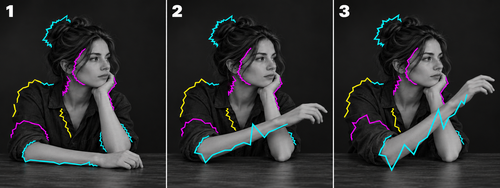

# 輪郭表現の基準

2026-10-22の画像比較で確認した方向。下の画像は生成した参考画像で、実装のスクリーンショットではない。

- 一本で全体を囲まず、輪郭に沿った長めの線を複数置く。
- 各線は点を結んだ連続した折れ線。細かな点滅や短い破片を基本の見た目にしない。
- 角は鋭く保ち、折れ曲がりの間隔を広げて長い直線でつなぐ。
- 線は映像の輪郭へ追従する。動きの大きな部分ほど、ギザギザも大きく揺らぐ。
- 同じ画面・同じ一本の線の中にも、静かな区間、小さい折れ曲がり、大きな飛び出しを混ぜる。
- 最大の強さは右端③を基準とする。静かな入力でもごく弱い形の変化を残す。
- 空間的なギザギザの間隔と、時間的に揺らぐ速さは独立して操作する。

「Motion Lightning」を入口とし、「変形強度」で全体の振れ幅、「動きへの反応」で動静の差、「線内の強弱」で大小の不均一さを調整する。形状の混合や断片線は引き続き個別に選択できる。
